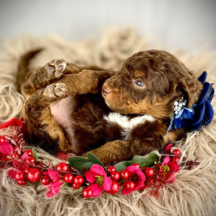

<section class="preparing-puppies">
  

    <h2>HEALTH GUARANTEE</h2>
    
When you take your four-legged friend home, he or she comes with a one-year health guarantee, and a spay/neuter contract. We deworm each puppy at two, four, six, and eight weeks old. When the puppies are 7-8 weeks old, we will take them to our vet for their first set of puppy shots, and checked out from head to toe. We have their dewclaws removed within the first five days of life so it doesn't get caught on something, ripped, and infected later on. All our puppies are fed the Costco Nature's Domain Chicken and Pea puppy kibble and nursed several times each day.

    
We also start potty training our puppies at three weeks old, and we provide the best possible start and wide array of socialization skills that will be a life foundation for each puppy and be able to promote the best possible temperament and socially sound puppy for you. When it’s time to pick him or her up, your fur baby will be bright-eyed, bushy-tailed, and ready to love you!

  

  

  

</section>

<section class="puppy-take-home">
  

    <h2>What we will be sending home with your fur baby:</h2>
    <ul class="puppy-take-home__list">
      <li>Vet vaccination and deworming records.</li>
      <li>Nail clippers. Small ones for now, larger ones for later. We suggest pretending to cut their nails often as this will make cutting their nails a breeze in the future.</li>
      <li>A couple toys.</li>
      <li>Blanket that smells like momma and the puppy's siblings.</li>
      <li>Leash and collar. No need to buy an expensive collar right now as your puppy grows so quickly.</li>
      <li>Sales contract/Health guarantee.</li>
      <li class="puppy-take-home__food">A small baggy of the puppy food that your little one has been eating (Nature's Domain Puppy Chicken and Pea Formula). It won't last long, but it is enough to get you through the ride home if you have a long drive or if you didn't get to the store to pick up a bag of their food yet. If you prefer to feed your fur baby a different kind of puppy food, get at least one bag of Nature's Domain and mix it half-and-half with the puppy food you prefer so your fur baby's stomach has enough time to get used to the new kind of puppy food. You'll need to feed your fur baby puppy food for a full year! A good rule of thumb when choosing a dog or puppy food is to make sure that the first two ingredients do not contain any kind of "meal." So try to avoid chicken meal, beef meal, fish meal, etc. "Meal" is the waste material such as organs, blood, bones, and feathers of the animal or fish that is from slaughterhouses that is processed and not fit for human consumption.</li>
      <li>Pee pads (a few to get you home).</li>
    </ul>
  

</section>
